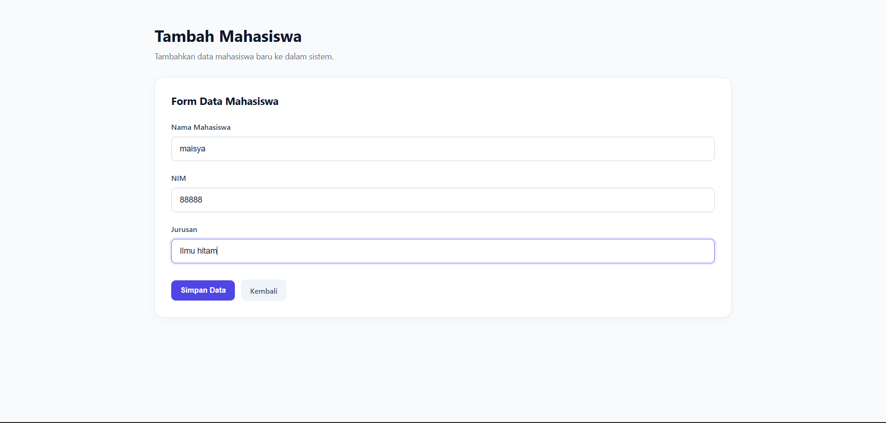
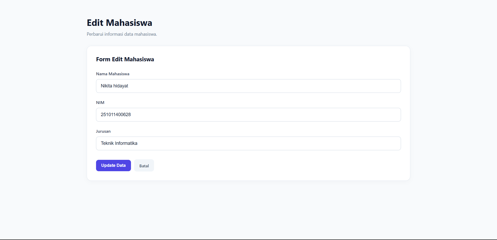

 <div align="center">

# STUDENT MANAGEMENT SYSTEM

**A Modern Student Data Management Application**

A simple web-based application designed to manage student records efficiently through a clean and intuitive interface.

<br>


<br><br>

[Overview](#overview) · [Features](#features) · [Preview](#application-preview) · [Installation](#installation)

</div>

---

## Overview

Student Management System is a web application developed to simplify the management of student information.

Built with Node.js, Express.js, EJS, and MySQL, this application provides essential data management functionality through a minimal and user-friendly interface.

## Features

| Feature | Description |
|:--|:--|
| **Create** | Add new student records |
| **Read** | Display student information |
| **Update** | Edit existing student records |
| **Delete** | Remove student records |
| **Database** | MySQL database integration |
| **Interface** | Minimalist and responsive design |

## Technology Stack

| Technology | Purpose |
|:--|:--|
| Node.js | JavaScript runtime |
| Express.js | Backend framework |
| EJS | Template engine |
| HTML & CSS | User interface |
| MySQL | Relational database |

## Application Preview

<div align="center">

**01 — Student Dashboard**


<sub>Centralized view of student records and information.</sub>

<br><br>

**02 — Add Student**



<sub>A simple form for registering new student information.</sub>

<br><br>

**03 — Edit Student**



<sub>Update student information with ease.</sub>

</div>

## Project Structure

```text
student-management-system/
│
├── images/
│   ├── datadsswa.png
│   ├── tambahsiswa.png
│   └── edit.png
│
├── public/
│   └── css/
│       ├── input.css
│       └── style.css
│
├── views/
│   ├── index.ejs
│   ├── tambah.ejs
│   └── edit.ejs
│
├── index.js
├── package.json
├── package-lock.json
├── tailwind.config.js
├── vercel.json
├── .gitignore
└── README.md
```

## Installation

### Prerequisites

Make sure you have installed:

- Node.js
- NPM
- MySQL

### 1. Clone Repository

```bash
git clone https://github.com/USERNAME/student-management-system.git
```

### 2. Navigate to Project

```bash
cd student-management-system
```

### 3. Install Dependencies

```bash
npm install
```

### 4. Setup Database

Create a MySQL database:

```sql
CREATE DATABASE kampus_db;

USE kampus_db;

CREATE TABLE mahasiswa (
    id INT AUTO_INCREMENT PRIMARY KEY,
    nama VARCHAR(100) NOT NULL,
    nim VARCHAR(30) NOT NULL,
    jurusan VARCHAR(100) NOT NULL
);
```

### 5. Configure Database

Adjust the database configuration in `index.js` according to your local MySQL setup.

### 6. Run Application

```bash
node index.js
```

Open your browser:

```text
http://localhost:3000
```

---

<div align="center">

### STUDENT MANAGEMENT SYSTEM

Designed for simplicity. Built for efficiency.

<br>

**Olenn · 2026**

</div>